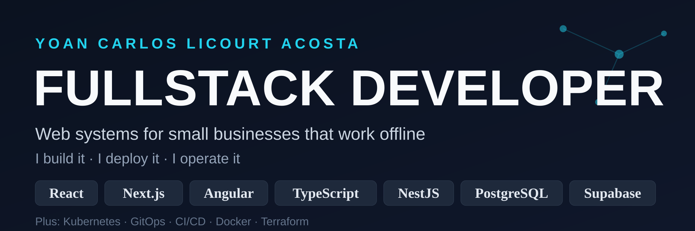

# 💫 About Me:
Fullstack Developer building web systems for small businesses that work offline: a management SaaS for Cuban mipymes (CajaYa — invoicing, inventory, cash register — live in production), ecommerce platforms, and client websites for real-estate and logistics businesses. React, Next.js, Angular and TypeScript on the frontend; NestJS, Node.js and Django on the backend; PostgreSQL and Supabase for data. My edge: a Senior DevOps & Infrastructure background — everything I build, I also deploy, back up and operate (Kubernetes, GitOps, CI/CD, observability).

## 🌐 Socials:
    

## 💻 Tech Stack

### 🎨 Frontend

### ⚙️ Backend

### 🗄️ Databases

### ☁️ DevOps & Infrastructure

### 🔄 CI/CD & GitOps

### 📊 Monitoring

### 🖥️ Virtualization

### 🐧 Operating Systems & Scripting

# 🚀 Featured Projects

<table>
<tr>
<td colspan="2">

## 🛒 Ecommerce Full-Stack Platform

Complete ecommerce platform with Angular 18 frontend and NestJS backend, deployed to production.

### Highlights
✅ JWT authentication  
✅ PayPal payment integration  
✅ Order confirmation emails  
✅ Light/dark mode UI  
✅ Deployed on Vercel  

🔗 [Frontend](https://github.com/yclicourt/ecommerce-frontend) · [Backend](https://github.com/yclicourt/ecommerce-backend)

</td>
</tr>

<tr>
<td width="50%">

## 💰 CajaYa — Mipyme Management SaaS

Live SaaS I founded for Cuban small businesses (mipymes): invoicing, inventory and daily cash-register control in one installable PWA.

### Highlights
✅ Multi-tenant with Supabase Auth + Row Level Security  
✅ Atomic stock decrement and consecutive invoice numbering (Postgres RPCs)  
✅ PDF invoices shared via WhatsApp  
✅ Offline data reading with a persisted client cache  
✅ Member invitations and daily cash-register close  

🔗 [Live app](https://caja-ya-saas.vercel.app/)

</td>

<td width="50%">

## 🔧 Buildora — Full-Stack Scaffold Generator

Free open-source scaffold generator (MIT): one command generates a complete full-stack project with auth, database, Docker and CI working from the first commit.

### Highlights
✅ Three golden paths: Next.js + NestJS, React + Vite + Django, Angular + FastAPI  
✅ Built first as three real, tested apps — then extracted into templates  
✅ Auth, Docker and CI working from the first commit  
✅ Generated code is 100% yours, no lock-in  
✅ Free on npm: `npx buildora generate my-app`  

🔗 [npm](https://www.npmjs.com/package/buildora) · [Landing](https://buildora-landing.vercel.app/) · [Template repo](https://github.com/yclicourt/buildora-template-path-1)

</td>
</tr>

<tr>
<td width="50%">

## 🏠 WelcomeHome — Real Estate Platform

Client project: real estate platform for a Cuban real estate company, with public listings and an admin panel.

### Highlights
✅ Public property listings and detail pages  
✅ Admin panel to manage published properties  
✅ Supabase backend (PostgreSQL + Auth + Storage)  
✅ React + Vite + TypeScript frontend  
✅ Deployed on Vercel  

🔗 [Live app](https://welcome-home-inmobiliary.vercel.app/)

</td>

<td width="50%">

## 🚚 REIKO'S LLC — Logistics Landing

Corporate landing page for a logistics company, with service pages and a working quote-request form.

### Highlights
✅ Transport, Storage and Logistics service pages  
✅ Animated image carousel  
✅ Quote-request contact form (Formspree)  
✅ Optimized WebP imagery (5.2 MB → 364 KB)  
✅ Deployed on Vercel  

🔗 [Live site](https://reikosllc.vercel.app/)

</td>
</tr>
</table>

## 🏗️ Infrastructure Experience

Experienced in designing, automating, and managing modern infrastructure platforms following DevOps and cloud-native practices.

### ☸️ Container Platforms & Orchestration

* Administration of Kubernetes clusters with k3s
* Containerized application deployments using Docker
* Kubernetes workload management with Deployments, StatefulSets, Services, ConfigMaps, Secrets, and Ingress

### ⚙️ Infrastructure as Code & Automation

* Infrastructure provisioning and management using Terraform
* Modular Infrastructure as Code design for scalable environments
* Configuration management and automation workflows using Ansible

### 🚀 DevOps & GitOps Practices

* GitOps-based application delivery using ArgoCD
* CI/CD pipeline automation with GitHub Actions and GitLab CI
* Automated build, deployment, and infrastructure workflows

### 🐧 Systems & Virtualization

* Linux server administration and troubleshooting
* Enterprise virtualization environments with VMware and Proxmox
* Networking, storage, and infrastructure operations

### 📊 Observability & Platform Operations

* Monitoring and alerting solutions with Prometheus and Grafana
* Centralized logging with Loki
* Building visibility into Kubernetes-based platforms and applications

## 📈 GitHub Stats

## 📈 GitHub Activity

## 🎯 Currently Learning
- Advanced Terraform
- Ansible Automation
- Helm Charts
- Platform Engineering
- Cloud Architecture

