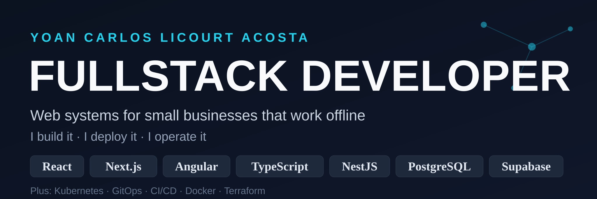

# 💫 About Me:
Fullstack Developer building web systems for small businesses that work offline: a management SaaS for Cuban mipymes (CajaYa — invoicing, inventory, cash register — live in production), ecommerce platforms, and client websites for real-estate and logistics businesses. React, Next.js, Angular and TypeScript on the frontend; NestJS, Node.js and Django on the backend; PostgreSQL and Supabase for data. My edge: a Senior DevOps & Infrastructure background — everything I build, I also deploy, back up and operate (Kubernetes, GitOps, CI/CD, observability).

## 🌐 Socials:
    

## 💻 Tech Stack

### 🎨 Frontend

### ⚙️ Backend

### 🗄️ Databases

### ☁️ DevOps & Infrastructure

### 🔄 CI/CD & GitOps

### 📊 Monitoring

### 🖥️ Virtualization

### 🐧 Operating Systems & Scripting

# 🚀 Featured Projects

<table>
<tr>
<td colspan="2">

## 🛒 Ecommerce Full-Stack Platform

Complete ecommerce platform with Angular 18 frontend and NestJS backend, deployed to production.

### Highlights
✅ JWT authentication  
✅ PayPal payment integration  
✅ Order confirmation emails  
✅ Light/dark mode UI  
✅ Deployed on Vercel  

🔗 [Frontend](https://github.com/yclicourt/ecommerce-frontend-angular) · [Backend](https://github.com/yclicourt/ecommerce-backend)

</td>
</tr>

<tr>
<td width="50%">

## 📦 Terraform Docker Platform

A modular Infrastructure as Code project deploying a full-stack application using Terraform and Docker Provider.

### Highlights
✅ Terraform modules architecture  
✅ Container lifecycle automation  
✅ PostgreSQL persistence with volumes  
✅ Network isolation  
✅ Environment-based configuration  

🔗 [Repository](https://github.com/yclicourt/terraform-modules-task-app-fullstack)

</td>

<td width="50%">

## ☸️ Terraform Kubernetes Platform

Production-like Kubernetes infrastructure deployed using Terraform.

### Highlights
✅ StatefulSets for databases  
✅ Deployments for applications  
✅ ConfigMaps & Secrets management  
✅ Kubernetes Services  
✅ Ingress routing  

🔗 [Repository](https://github.com/yclicourt/terraform-modules-kubernetes-tasks-app-fullstack)

</td>
</tr>

<tr>
<td width="50%">

## 🚀 GitOps Continuous Delivery

GitOps workflow implementing declarative Kubernetes deployments.

### Highlights
✅ Automated deployments  
✅ Git-based infrastructure management  
✅ Kubernetes application synchronization  
✅ Continuous delivery workflow  

🔗 [Repository](https://github.com/yclicourt/deploy-gitOps-app)

</td>

<td width="50%">

## 🏗️ Tasks App — Complete Platform Engineering

End-to-end platform: `git push` → GitHub Actions (lint, test, Trivy) → Harbor → ArgoCD app-of-apps → Gateway API + TLS. Sealed Secrets, cert-manager, Kyverno policies, OpenObserve observability, Velero backups. Every layer declared in git.

### Highlights
✅ GitOps app-of-apps with sync waves
✅ Gateway API routing + automated TLS (cert-manager)
✅ Policy enforcement with Kyverno
✅ Distributed tracing with OpenTelemetry
✅ Scheduled backups with Velero

🔗 [Repository](https://github.com/yclicourt/tasks-app-platform-devops)

</td>
</tr>
</table>

## 🏗️ Infrastructure Experience

Experienced in designing, automating, and managing modern infrastructure platforms following DevOps and cloud-native practices.

### ☸️ Container Platforms & Orchestration

* Administration of Kubernetes clusters with k3s
* Containerized application deployments using Docker
* Kubernetes workload management with Deployments, StatefulSets, Services, ConfigMaps, Secrets, and Ingress

### ⚙️ Infrastructure as Code & Automation

* Infrastructure provisioning and management using Terraform
* Modular Infrastructure as Code design for scalable environments
* Configuration management and automation workflows using Ansible

### 🚀 DevOps & GitOps Practices

* GitOps-based application delivery using ArgoCD
* CI/CD pipeline automation with GitHub Actions and GitLab CI
* Automated build, deployment, and infrastructure workflows

### 🐧 Systems & Virtualization

* Linux server administration and troubleshooting
* Enterprise virtualization environments with VMware and Proxmox
* Networking, storage, and infrastructure operations

### 📊 Observability & Platform Operations

* Monitoring and alerting solutions with Prometheus and Grafana
* Centralized logging with Loki
* Building visibility into Kubernetes-based platforms and applications

## 📈 GitHub Stats

## 📈 GitHub Activity

## 🎯 Currently Learning
- Advanced Terraform
- Ansible Automation
- Helm Charts
- Platform Engineering
- Cloud Architecture

